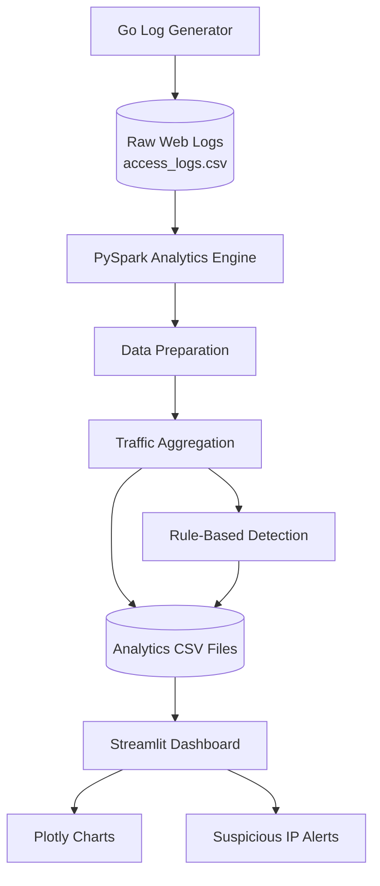

# ThreatStream: Big Data-Based Web Traffic Analytics and Attack Detection


ThreatStream is a cybersecurity and Big Data mini-project that analyzes web access logs, identifies suspicious traffic patterns using predefined detection rules, and visualizes the results through an interactive dashboard.

The project demonstrates how raw web traffic data can be transformed into meaningful security insights using Go, Python, Apache Spark (PySpark), Streamlit, and Plotly.

**Current implementation:** Local batch processing using synthetic web traffic logs.

---

## Table of Contents

1. [Introduction](#1-introduction)
2. [Problem Statement](#2-problem-statement)
3. [Objectives](#3-objectives)
4. [Key Features](#4-key-features)
5. [Technologies Used](#5-technologies-used)
6. [Project Architecture](#6-project-architecture)
7. [Data Flow](#7-data-flow)
8. [Project Structure](#8-project-structure)
9. [System Requirements](#9-system-requirements)
10. [Installation and Setup](#10-installation-and-setup)
11. [How to Run the Project](#11-how-to-run-the-project)
12. [Detection Methodology](#12-detection-methodology)
13. [Output Files](#13-output-files)
14. [Dashboard Features](#14-dashboard-features)
15. [Sample Results](#15-sample-results)
16. [Testing](#16-testing)
17. [Limitations](#17-limitations)
18. [Future Enhancements](#18-future-enhancements)
19. [Learning Outcomes](#19-learning-outcomes)
20. [Conclusion](#20-conclusion)

---

## 1. Introduction

Web applications generate large amounts of access log data containing information about incoming requests, IP addresses, requested resources, HTTP methods, status codes, and response sizes.

Analyzing these records manually can become difficult as the volume of data increases. Suspicious activities such as repeated login failures, repeated forbidden requests, endpoint scanning, and unusually high request volumes may be difficult to identify without automated analysis.

ThreatStream addresses this problem by using PySpark to process web traffic logs and produce aggregated security information. It then presents the results through an interactive Streamlit dashboard.

The project combines Big Data processing concepts with basic cybersecurity monitoring techniques.

## 2. Problem Statement

To develop a Big Data-based web traffic analytics system that processes web access logs, identifies IP addresses exhibiting suspicious request patterns, calculates useful traffic statistics, and displays the results through an interactive dashboard.

## 3. Objectives

- Generate synthetic web access logs using Go.
- Store log records in a structured CSV format.
- Process and aggregate log data using Apache Spark.
- Analyze request counts by IP address, endpoint, status code, and time window.
- Identify suspicious activity using predefined detection rules.
- Generate security summaries and alert reports.
- Visualize the results using Streamlit and Plotly.
- Demonstrate how Big Data analytics can support cybersecurity monitoring.

## 4. Key Features

### Web Traffic Generation
Generates 1,500 synthetic web access log records for testing and demonstration.

### Big Data Processing
Uses PySpark to read, prepare, aggregate, and analyze log records.

### IP Address Analytics
Calculates request counts and selected error statistics for individual IP addresses.

### Endpoint Analytics
Identifies frequently requested endpoints and highlights access to selected sensitive paths.

### HTTP Status Analysis
Summarizes responses such as HTTP 200, 401, 403, and 404.

### Suspicious Activity Detection
Flags IP addresses that match configured rules for repeated failed logins, suspicious endpoint access, forbidden requests, or high request volume.

### Interactive Dashboard
Displays summary metrics, charts, traffic trends, and rule-based alerts.

### Exportable Results
Saves processed analytics in CSV files for inspection and further analysis.

## 5. Technologies Used

| Technology | Purpose |
|---|---|
| Go | Synthetic web traffic log generation |
| Python | Analytics application and dashboard logic |
| Apache Spark / PySpark | Big Data processing and aggregation |
| Pandas | Handling tabular results |
| Streamlit | Interactive web dashboard |
| Plotly | Charts and data visualization |
| CSV | Input data and analytics output format |
| Java JDK 21 | Runtime for the Spark setup used in this project |

## 6. Project Architecture

The architecture follows a simple data processing pipeline.



### Architecture Explanation

1. **Go Log Generator:** Creates synthetic web access records.
2. **CSV Storage:** Stores the generated records in `data/access_logs.csv`.
3. **PySpark Analytics Engine:** Reads and processes the input data.
4. **Data Preparation:** Converts timestamps and numeric fields and removes records missing required fields.
5. **Traffic Aggregation:** Calculates statistics grouped by IP, endpoint, status code, and time window.
6. **Rule-Based Detection:** Applies predefined thresholds to flag suspicious IP addresses.
7. **Analytics Output:** Saves the processed summaries and alerts in the `outputs/` directory.
8. **Streamlit Dashboard:** Reads the output files and presents them as metrics, tables, and charts.

The current implementation runs locally and uses batch processing. It does not require a distributed Spark cluster or Kafka.

## 7. Data Flow

The complete data flow is:

1. The Go program generates synthetic web requests.
2. The requests are written to a CSV file.
3. PySpark reads the CSV file.
4. The analytics engine prepares and validates the records.
5. Spark calculates traffic statistics and grouped summaries.
6. Detection rules identify IP addresses that match suspicious patterns.
7. The processed summaries are exported to CSV files.
8. Streamlit reads the output files.
9. Plotly visualizes the traffic statistics.
10. The dashboard displays security metrics and suspicious-activity alerts.

## 8. Project Structure

```text
ThreatStream/
│
├── data/
│   └── access_logs.csv
│
├── outputs/
│   ├── summary.csv
│   ├── ip_summary.csv
│   ├── endpoint_summary.csv
│   ├── status_summary.csv
│   ├── alerts.csv
│   └── timeline_summary.csv
│
├── analytics/
│   └── process_logs.py
│
├── dashboard/
│   └── app.py
│
├── go-collector/
│   └── main.go
│
├── .venv/
├── requirements.txt
└── README.md
```

The `.venv/` directory contains the local Python environment and should not be committed to GitHub.

The `data/access_logs.csv` and output CSV files are generated when the project runs.

## 9. System Requirements

- Windows 10 or Windows 11
- Go installed and available in the terminal
- Python 3.13
- Java JDK 21
- Internet access for the initial package installation
- Visual Studio Code or another code editor
- Sufficient disk space for Python and Spark dependencies

The project uses a local Spark session, so a separate Hadoop cluster is not required.

## 10. Installation and Setup

### Step 1: Open the Project Directory

Open the `ThreatStream` folder in Visual Studio Code.

Open a PowerShell terminal and navigate to the project root:

```powershell
cd C:\Users\mohak\Desktop\ThreatStream
```

Adjust the path if the project is stored elsewhere.

### Step 2: Verify the Installed Tools

```powershell
go version
python --version
java -version
```

Verify that Go, Python, and Java are available in the terminal.

### Step 3: Create a Python Virtual Environment

```powershell
python -m venv .venv
```

### Step 4: Install the Required Libraries

```powershell
.\.venv\Scripts\python.exe -m pip install --upgrade pip
.\.venv\Scripts\python.exe -m pip install pyspark==4.0.2 streamlit plotly pandas
```

### Step 5: Save the Dependencies

Create or update `requirements.txt` with:

```text
pyspark==4.0.2
streamlit
plotly
pandas
```

To install the dependencies later:

```powershell
.\.venv\Scripts\python.exe -m pip install -r requirements.txt
```

## 11. How to Run the Project

Run all commands from the ThreatStream project root.

### Step 1: Generate Web Traffic Logs

```powershell
go run .\go-collector\main.go
```

Expected output:

```text
Success! Generated 1500 web access log records.
File: data/access_logs.csv
```

### Step 2: Run Big Data Analytics

```powershell
.\.venv\Scripts\python.exe .\analytics\process_logs.py
```

The analytics engine starts Spark, processes the log records, calculates traffic summaries, and saves the results.

The successful run should print a summary containing the number of records processed, unique IP addresses, and suspicious IPs flagged.

### Step 3: Start the Dashboard

```powershell
.\.venv\Scripts\python.exe -m streamlit run .\dashboard\app.py
```

Open the local dashboard in your browser:

http://localhost:8501

To stop the dashboard, press `Ctrl + C` in the terminal.

### Complete Execution Order

Always run the programs in this order:

1. Go log generator
2. PySpark analytics engine
3. Streamlit dashboard

The dashboard reads the previously generated analytics CSV files. If the raw logs change, run the analytics engine again before refreshing the dashboard.

## 12. Detection Methodology

ThreatStream uses rule-based detection rather than a trained machine-learning model.

The analytics engine groups requests by IP address and evaluates the resulting statistics against predefined thresholds.

| Detection Rule | Condition | Interpretation |
|---|---|---|
| Repeated failed logins | 5 or more HTTP 401 responses | Possible repeated login failures |
| Suspicious endpoint access | 3 or more requests to configured suspicious paths | Possible endpoint scanning |
| Repeated forbidden access | 5 or more HTTP 403 responses | Possible repeated unauthorized access attempts |
| High request volume | 100 or more requests from one IP | Possible unusually high traffic |

Configured suspicious paths include:

- `/admin`
- `/.env`
- `/wp-login.php`
- `/config`
- `/backup`

These conditions are simple demonstration thresholds, not universal security rules.

An IP address can trigger an alert for legitimate reasons. An alert should be investigated before concluding that malicious activity occurred.

## 13. Output Files

The analytics engine produces six output files.

| File | Description |
|---|---|
| `summary.csv` | Total requests, error requests, server errors, unauthorized requests, forbidden requests, and unique IP addresses |
| `ip_summary.csv` | Request counts and selected error counts grouped by IP address |
| `endpoint_summary.csv` | Request counts grouped by endpoint |
| `status_summary.csv` | Request counts grouped by HTTP status code |
| `alerts.csv` | IP addresses that matched the configured detection rules |
| `timeline_summary.csv` | Request counts grouped into five-minute time windows |

These files can be opened in Visual Studio Code, Excel, or another CSV viewer.

## 14. Dashboard Features

The Streamlit dashboard displays the following information:

### Traffic Overview
- Total requests
- Unique IP addresses
- Error requests
- Number of suspicious IP addresses flagged

### HTTP Status Distribution
Shows how requests are distributed across the observed HTTP status codes.

### Most Requested Endpoints
Shows which endpoints received the highest number of requests.

### Top IP Addresses
Compares the number of requests received from different IP addresses.

### Request Timeline
Displays request volume in five-minute time windows.

### Suspicious IP Alerts
Lists IP addresses matching one or more detection rules, together with the recorded reasons.

### Full IP Analytics
Displays the aggregated statistics for individual IP addresses.

## 15. Sample Results

In the initial successful test run, the analytics engine reported:

| Metric | Observed Result |
|---|---:|
| Records processed | 1,500 |
| Unique IP addresses | 8 |
| Suspicious IPs flagged | 8 |

These results describe the current synthetic dataset and configured detection rules. They are not performance benchmarks and do not demonstrate the detection of real attacks.

The number of alerts can change if the log generator, input dataset, or detection thresholds change.

## 16. Testing

Use the following checklist to verify the project.

- [ ] Go successfully generates the input CSV file.
- [ ] The CSV contains the expected columns.
- [ ] PySpark reads and processes the records.
- [ ] The analytics output files are created.
- [ ] Summary metrics agree with the generated data.
- [ ] Suspicious IP alerts contain detection reasons.
- [ ] The Streamlit dashboard loads without errors.
- [ ] Dashboard charts display the analytics output.
- [ ] The project runs again after regenerating the logs.

## 17. Limitations

- The current version uses synthetic web access logs rather than live production traffic.
- The system uses batch processing, not continuous real-time streaming.
- Detection depends on predefined rules and thresholds.
- Alerts can include false positives and do not confirm successful attacks.
- The application does not currently perform machine-learning-based attack classification.
- The prototype does not currently use Kafka, a distributed Spark cluster, or a persistent database.
- The dashboard is intended for a local educational demonstration, not production deployment.

## 18. Future Enhancements

Possible extensions include:

1. **Real Log Ingestion:** Process web server logs from an authorized test environment.
2. **Apache Kafka:** Add a message broker for continuous log ingestion.
3. **Streaming Analytics:** Use Spark Structured Streaming to analyze incoming events.
4. **Machine Learning:** Experiment with anomaly detection or classification using a suitable labeled dataset.
5. **Advanced Detection:** Add configurable time-window thresholds and more detailed detection rules.
6. **Database Integration:** Store processed metrics and alerts in a database.
7. **Alert Notifications:** Send notifications when selected rules are triggered.
8. **Authentication:** Restrict dashboard access and add appropriate access controls.
9. **Scalability Testing:** Benchmark processing performance with larger datasets.
10. **Cloud Deployment:** Explore deployment in a controlled cloud environment.

These are planned extensions and are not part of the current implementation.

## 19. Learning Outcomes

Through this project, the following concepts can be demonstrated:

- Structured log generation and data collection
- CSV-based data ingestion
- Big Data processing using Apache Spark
- Data preparation and aggregation
- Grouping and analyzing records by multiple fields
- Rule-based security monitoring
- Data visualization with Plotly
- Dashboard development using Streamlit
- Understanding the limitations of security alerts
- Designing an extensible analytics pipeline

## 20. Conclusion

ThreatStream demonstrates how Big Data processing techniques can support cybersecurity monitoring by transforming raw web traffic logs into aggregated statistics and suspicious-activity alerts.

Go generates the sample data, PySpark performs the analytics, and Streamlit and Plotly present the results in an interactive dashboard.

The project provides a practical introduction to the relationship between Big Data analytics and cybersecurity. Future development can extend the prototype toward real log ingestion, streaming analytics, and more advanced detection methods.

---

## Author

**Project:** ThreatStream

**Project Type:** Cybersecurity and Big Data Analytics Mini-Project

**Primary Focus:** Web Traffic Analytics and Suspicious Activity Detection

**Execution Mode:** Local Batch Processing

## Disclaimer

This project is developed for educational and demonstration purposes. It uses synthetic data and basic detection rules. It is not a substitute for a production security monitoring system, and its alerts should not be interpreted as proof of malicious activity.
